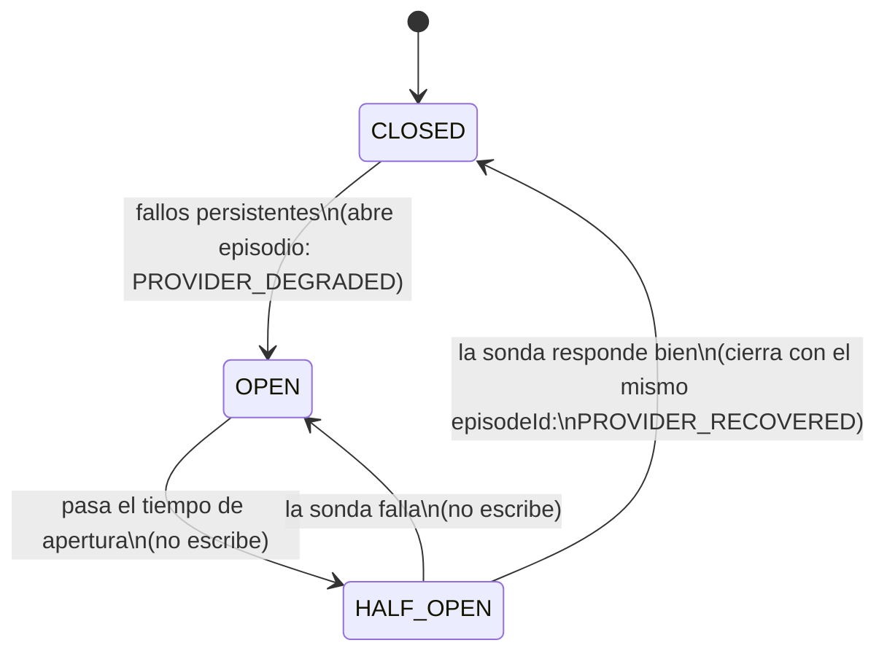

# HU-23 · Operación de integraciones (DC-322)

Sprint 4 · HU-23 (DC-130). Guía para el operador de Doggy y para quien reproduzca o pruebe la funcionalidad.

## 1. Qué hace

Muestra la salud observada de Bank Mock y Buró Mock, el alcance del problema y la recuperación, y avisa de forma contextual a Carlos (analista) sin exponer detalles técnicos. Definiciones en `HU-23-semantica-salud.md`.

## 2. Diagrama del episodio



## 3. Matriz de permisos

| Actor | `GET admin/platform/integrations[/:code]` | Pantalla "Integraciones" | `GET institution/tenants/:slug/integrations/status` |
|---|---|---|---|
| Anónimo | 401 | Redirige a `/admin/login` | 401 |
| OPERATOR | 200 | Sí | No aplica |
| PLATFORM_ADMIN | 200 (el guard lo admite) | No (solo Proveedores, regla HU-30) | No aplica |
| ANALYST / INSTITUTION_ADMIN | 403 | No | 200, solo su institución |

Guards: `InternalStaffGuard` (OPERATOR y PLATFORM_ADMIN) en el endpoint; `InstitutionSessionGuard` + `TenantContextGuard` en el de institución. Todos los endpoints son solo GET.

## 4. Qué ve cada persona

**Operador** (`/admin/integraciones`): estado por proveedor, última señal, confianza, afectados (desconocido vs ninguno), filtro por estado (`?estado=`, se conserva al ir al detalle y volver) e "Información avanzada" con el estado técnico del breaker. Si hay degradación aparece un banner en todo el panel (se oculta dentro de Integraciones; refresco al navegar y cada 60 s). No avisa de "Error de monitoreo", para no generar ruido.

**Carlos / Ana**: aviso amarillo "Fuentes con interrupción temporal" en el paso 3 de Nueva evaluación y en evaluaciones DRAFT/FAILED. Solo con `TEMPORARILY_UNAVAILABLE`. `UNKNOWN` o errores de consulta no muestran nada. Sin códigos del breaker, conteos ni otras instituciones, y sin botón de ticket. El botón Reintentar de HU-25 no se tocó.

Mapeo: `DEGRADADO_OBSERVADO` o deshabilitado globalmente → `TEMPORARILY_UNAVAILABLE`; `OPERATIVO_OBSERVADO` → `AVAILABLE`; `SIN_SENAL_RECIENTE` / `ERROR_MONITOREO` → `UNKNOWN`.

## 5. Cómo reproducir (solo desarrollo)

| CI | Efecto en los mocks |
|---|---|
| `…999` | Bank y Buró fallan (UNAVAILABLE) → abre el breaker |
| `…500` | Bank y Buró fallan (ERROR) |
| `…001` | NO_DATA solo en el Buró (no es caída) |
| `…000` | NO_DATA en ambos |
| `7812456` | Éxito (María Fernanda Rojas) |

Para la prueba en vivo se baja `HEALTH_MIN_SAMPLES` a 3 y se **restaura a 10** al terminar.

Variable de entorno relacionada: `SEED_DEMO_HU23_BUREAU=true` (parche de seed opcional que habilita el Buró en las instituciones demo). Sin él, el Buró se habilita desde la app como Ana. El seed base no se modificó.

Secuencia: (A) `1234001` ×3 → Buró operativo, sin episodio. (B) `1234999` → degradado, protección temporal, episodio abierto. (C) esperar >30 s y evaluar `7812456` → operativo, sin episodio.

Login: operador y admin de plataforma en `http://localhost:5173/admin/login`; Carlos y Ana en `/iniciar-sesion`. Probar la API contra `http://localhost:5173/api` con `Origin: http://localhost:5173` y `x-doggycredit-admin: 1`.

"Buró cae y Bank sigue" solo se reproduce con tests (`hu23-partial-outage.spec.ts`), porque los mocks fallan juntos.

## 6. Pruebas automáticas

```powershell
npm run test:hu23 --workspace=@doggycredit/api
```

Cubre `hu23-*`, `provider-health`, `provider-episode`, `integration-status` e `internal-staff`. En web: `IntegrationNotice.test.tsx`.

## 7. Límites abiertos

- Breaker por instancia: con dos réplicas puede haber estados distintos; el episodio (AuditLog) sí es compartido.
- Dos instancias que abran casi a la vez podrían escribir dos `PROVIDER_DEGRADED` (carrera sin bloqueo).
- Si se reinicia la instancia que abrió el episodio, este queda abierto en AuditLog hasta haber evidencia de recuperación (mitigado en lectura por `effectiveBreaker`; no se cierra en AuditLog).
- Con muy pocas muestras el estado es "operativo, confianza baja", aunque todas hayan fallado.
- Ventana, TTL y umbrales son PROPUESTO.
- No hay ciclo de incidentes persistidos ni tickets (CA-23.16); la UI no promete seguimiento manual.
- Tras recuperarse, el operador ve "Operativo" sin aviso de "se recuperó hace X" (el endpoint no devuelve episodios cerrados).
- El aviso a Carlos cambia solo con una consulta real, no con el paso del tiempo.
- No hay tests web para `IntegrationsPage`, `IntegrationDetailPage` ni el banner de `AdminLayout`.
- En pantalla, con CI `…999`, el mensaje de error del analista menciona al Buró aunque caen ambos (texto de error; no afecta a la salud).

## 8. Evidencia

**Prueba en vivo del 20-oct-2026** (`HEALTH_MIN_SAMPLES=3`):

| Parte | Resultado observado |
|---|---|
| A. NO_DATA no es caída | CI `1234001` ×3 → Buró `OPERATIVO_OBSERVADO`, `failures:0`, `episode:null`, `breakerState:CLOSED` |
| B. Caída real | CI `1234999` → `DEGRADADO_OBSERVADO`, "Protección temporal activa", `breakerState:OPEN`, episodio `5adeb5e9-4103-4be6-b675-e062c82cbcfa`, afectados: Banco del Sol Demo |
| C. Recuperación | Tras >30 s, CI `7812456` → `OPERATIVO_OBSERVADO`, `episode:null`, afectados `[]` |
| T05 | Aviso amarillo visible en detalle de evaluación y paso 3; el endpoint devuelve solo `providerName`, `availability`, `message` |
| T04 | Menú, tabla, filtro, detalle, banner e "Información avanzada" revisados |

**Ronda de verificación en vivo posterior** (episodios sin duplicados, GET sin escritura, protección de datos, permisos, accesibilidad): ejecutada por el responsable del sprint el 20-oct-2026; **todas las comprobaciones funcionaron**. No se registró el detalle por prueba.

**Verificación automática (20-oct-2026):**

| Comando | Resultado |
|---|---|
| `npm run build --workspace=@doggycredit/api` | Sin errores |
| `npm run test:hu23 --workspace=@doggycredit/api` | 9 suites, **58 tests**, todos OK |
| `npm run test --workspace=@doggycredit/api -- hu23` | 4 suites, 17 tests, todos OK (solo los archivos `hu23-*`) |
| `npm run test --workspace=@doggycredit/api` | **38 suites, 253 tests**, todos OK (antes de HU-23 T05/T07: 33 suites / 231 tests) |
| `npm run test --workspace=@doggycredit/web` | **20 archivos, 148 tests**, todos OK (incluye `IntegrationNotice.test.tsx`, 3 tests) |
| `npm run build --workspace=@doggycredit/web` | Sin errores |

Avisos que aparecen y **no son fallos**:
- Logs `WARN` de Nest en los tests (`breaker CLOSED -> OPEN`, `no se pudo registrar la transición de salud`): salen de specs que simulan la apertura del breaker y un fallo de escritura de auditoría.
- Vite: chunk mayor a 500 kB (preexistente, ajeno a HU-23).
- React: `<h2>`/`<p>`/`<dialog>` anidados en `RequestReceivedPage` (HU-02, preexistente, ajeno a HU-23).

**Configuración al cierre (verificada):** `.env` con `HEALTH_WINDOW_SECONDS=900`, `HEALTH_SIGNAL_TTL_SECONDS=600`, `HEALTH_MIN_SAMPLES=10` (restaurado tras la prueba en vivo con 3) y `HEALTH_FAILURE_RATIO=0.5`, coherentes con `HU-23-semantica-salud.md`.
